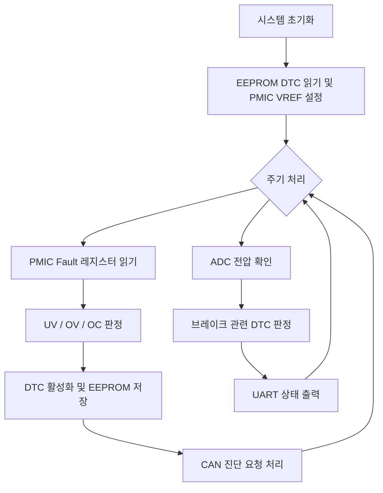

# STM32F413 기반 ECU 진단 및 DTC 관리 펌웨어

STM32F413ZH를 기반으로 **PMIC 고장 감지, DTC(Diagnostic Trouble Code) 관리, EEPROM 기록, CAN 진단 통신**을 구현한 임베디드 펌웨어 학습 프로젝트입니다.

코멘토 임베디드 SW 직무부트캠프의 제공 코드를 바탕으로 시작하여, 주변장치 통신과 차량 진단 로직을 구현하고 **Super Loop 구조를 FreeRTOS 기반 주기 태스크로 확장**했습니다. 별도 브랜치에서는 스마트 하이사이드 스위치의 데이터시트를 분석하고 GPIO·ADC 기반 진단 드라이버를 추가했습니다.

> **프로젝트 성격:** 교육·실습용 프로토타입입니다. 실제 차량의 안전 필수 제어 시스템에 적용하기 위한 검증을 마친 소프트웨어가 아닙니다.

## 개발 환경

| 구분 | 내용 |
| --- | --- |
| MCU | STMicroelectronics STM32F413ZH (Arm Cortex-M4) |
| 언어 | C |
| 개발 도구 | STM32CubeIDE, STM32CubeMX |
| 펌웨어 | STM32 HAL, CMSIS |
| RTOS | FreeRTOS / CMSIS-RTOS2 (`RTOS`, `bts7008` 브랜치) |
| 주변장치 | I2C, SPI, CAN(bxCAN), UART, ADC, DMA, GPIO |
| 관련 IC | MP5475 PMIC, 25LC256 EEPROM, TJA1051 CAN Transceiver |
| 추가 실습 IC | Infineon BTS7008-2EPA (`bts7008` 브랜치) |

## 주요 기능

### 1. I2C — PMIC 제어 및 고장 감지

- MP5475 PMIC 데이터시트를 바탕으로 출력 전압 기준값(VREF) 설정 기능 구현
- I2C를 통해 전압·전류 관련 Fault 레지스터 읽기
- 레지스터 비트 필드를 분석하여 UV(저전압), OV(과전압), OC(과전류) 상태 확인
- RTOS 브랜치에서는 **I2C DMA 전송 완료 콜백과 세마포어**를 연계하여 통신 완료 대기

### 2. SPI — EEPROM에 DTC 저장 및 복원

- 25LC256 EEPROM의 `WREN`, `WRITE`, `READ` 명령을 사용한 데이터 접근
- 감지된 고장 정보를 DTC 구조체로 관리하고 EEPROM에 기록
- 초기화 과정에서 EEPROM에 저장된 DTC 읽기
- RTOS 브랜치에서는 **SPI DMA 및 완료 세마포어**를 이용한 송수신 흐름 구현

### 3. CAN — UDS 기반 진단 요청 처리

- CAN RX FIFO0 수신 인터럽트 및 콜백을 이용해 진단 요청 수신
- 구현된 UDS 서비스 일부:
  - `0x19` / Sub-function `0x02`: DTC 정보 조회 요청 처리
  - `0x14`: DTC 활성 상태 초기화 및 EEPROM 반영
- 정상 응답 및 지원하지 않는 하위 기능에 대한 부정 응답 로직 작성
- CAN 응답 ID `0x7E8` 사용

> UDS의 일부 서비스 흐름을 학습 목적으로 구현한 것이며, ISO-TP 및 전체 ISO 14229 서비스를 완성한 구현은 아닙니다. OBD-II 관련 코드는 일부 주석으로 남아 있습니다.

### 4. ADC · UART — 상태 모니터링

- ADC를 통해 전압 입력을 읽고 설정한 범위를 벗어나면 브레이크 관련 DTC 활성화
- 고장 유무에 따라 UART로 시스템 상태 메시지 출력
- `bts7008` 브랜치에서는 ADC 측정값으로 BTS7008-2EPA의 진단 신호를 판정하고, 고장 판단 시 출력 제어를 수행하도록 코드 작성

### 5. FreeRTOS — 주기 태스크와 동기화

`RTOS` 브랜치에서는 기존 Super Loop에서 처리하던 기능을 다음과 같이 분리했습니다.

| 태스크 | 주기(설정) | 주요 작업 |
| --- | --- | --- |
| `StartTask_1ms` | 1 ms | PMIC Fault 읽기, DTC 처리, CAN 요청 처리 |
| `StartTask_5ms` | 5 ms | ADC 전압 확인, 관련 DTC 기록, UART 상태 출력 |

- `vTaskDelayUntil()`로 주기적인 태스크 실행 구성
- 공유 자원 접근을 위한 **Mutex** 사용
- I2C/SPI의 DMA 전송 완료를 알리는 **Semaphore** 사용
- 실제 실행 시간 및 주기 충족 여부에 대한 정량 측정 결과는 별도 제시하지 않음

## 동작 흐름



이 흐름은 주요 기능을 개념적으로 요약한 것입니다. 실제 실행 방식은 브랜치에 따라 다르며, `RTOS` 브랜치에서는 위 작업을 1ms/5ms 태스크로 분리합니다.

## 브랜치 구성

| 브랜치 | 내용 |
| --- | --- |
| [`main`](https://github.com/qwerasdfuiop/comento/tree/main) | Super Loop 기반 PMIC·EEPROM·DTC·CAN·UART 구현과 테스트 코드 |
| [`RTOS`](https://github.com/qwerasdfuiop/comento/tree/RTOS) | FreeRTOS 포팅, 1ms/5ms 태스크 분리, Mutex·Semaphore·DMA 연계 |
| [`bts7008`](https://github.com/qwerasdfuiop/comento/tree/bts7008) | RTOS 버전 기반 BTS7008-2EPA GPIO 제어 및 ADC 진단 로직 추가 |

> **참고:** 저장소의 기본 브랜치는 `main`입니다. RTOS 관련 구현을 확인하려면 `RTOS` 브랜치로 전환해야 하며, BTS7008 기능은 `bts7008` 브랜치에 있습니다.

## 주요 소스 파일

```text
comento/
├── RTOS_DTC_Comento/
│   ├── Core/
│   │   ├── Inc/
│   │   │   ├── PMIC.h
│   │   │   ├── EEPROM.h
│   │   │   ├── DTC.h
│   │   │   ├── OBD2UDS.h
│   │   │   └── TestCase.h
│   │   └── Src/
│   │       ├── main.c           # 주변장치 초기화 및 실행 흐름
│   │       ├── PMIC.c           # PMIC I2C 제어 / Fault 읽기
│   │       ├── EEPROM.c         # SPI EEPROM 읽기 / 쓰기
│   │       ├── DTC.c            # Fault → DTC 변환
│   │       ├── OBD2UDS.c        # CAN 진단 요청 및 응답
│   │       └── TestCase.c       # White / Black Box 테스트 코드
│   └── RTOS_DTC_Comento.ioc     # STM32CubeMX 설정
├── Sample_Code/                # 제공 예제 코드
└── *.pdf                       # 데이터시트 및 참고 문서
```

`RTOS` 브랜치에는 FreeRTOS 관련 파일이 포함되며, `bts7008` 브랜치에는 `BTS7008.c` / `BTS7008.h`가 추가됩니다.

## 테스트 코드

`TestCase.c`에 아래 4개 테스트 시나리오를 작성했습니다.

| 분류 | 테스트 | 확인 대상 |
| --- | --- | --- |
| White Box | `WB_TC01_FaultBitDecode` | PMIC Fault 레지스터 비트 해석 |
| White Box | `WB_TC02_FaultToDTC` | Fault 정보의 DTC 변환 |
| Black Box | `BB_TC01_ReadDtcResponse` | UDS ReadDTC 응답 데이터 |
| Black Box | `BB_TC02_UnsupportedSubFunction` | 미지원 Sub-function에 대한 부정 응답 |

현재 저장소에는 테스트 코드가 포함되어 있으나, **모든 테스트 통과 및 실제 하드웨어 검증을 입증하는 결과는 포함되어 있지 않습니다.**

## 빌드 방법

1. 저장소를 복제합니다.

   ```bash
   git clone https://github.com/qwerasdfuiop/comento.git
   cd comento
   ```

2. 살펴볼 구현에 맞는 브랜치로 전환합니다.

   ```bash
   git switch RTOS
   # 또는 git switch bts7008
   ```

3. **STM32CubeIDE**에서 `RTOS_DTC_Comento` 프로젝트를 가져옵니다.
4. 필요하면 `RTOS_DTC_Comento.ioc`를 열어 MCU 주변장치 및 핀 설정을 확인합니다.
5. 프로젝트를 빌드합니다. 실제 보드에서 실행하려면 해당 하드웨어 연결과 주변장치 구성을 별도로 확인해야 합니다.

## 향후 개선 과제

- DMA/HAL 오류 및 타임아웃 처리 보강
- EEPROM 쓰기 완료 상태 확인과 데이터 무결성 관리
- FreeRTOS 태스크 실행 시간 및 주기 충족 여부 측정
- UDS 응답 형식과 ISO-TP 처리 확장
- 테스트 코드 정비 및 실제 하드웨어 기반 검증 결과 추가
- BTS7008 진단 로직의 경계 조건·전기적 연결·ADC 값 검증

## 참고

- STM32F413 Reference Manual (RM0430) / Datasheet
- MP5475, 25LC256, TJA1051, BTS7008-2EPA Datasheet
- ISO 14229-1: UDS (Unified Diagnostic Services)

**출처 및 사용 범위:** 본 저장소는 코멘토 직무부트캠프 제공 예제 코드를 기반으로 진행한 학습 프로젝트입니다. 제조사 라이브러리·데이터시트·표준 문서 등 제3자 자료에는 각 권리자의 라이선스와 배포 조건이 적용됩니다.
